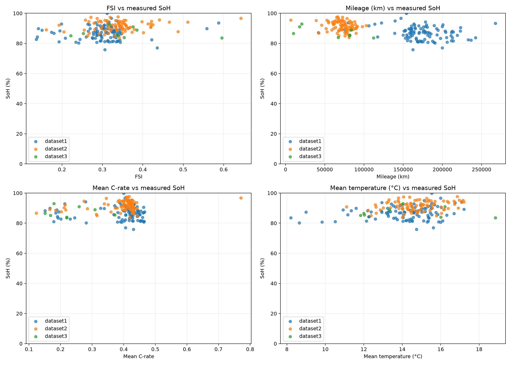
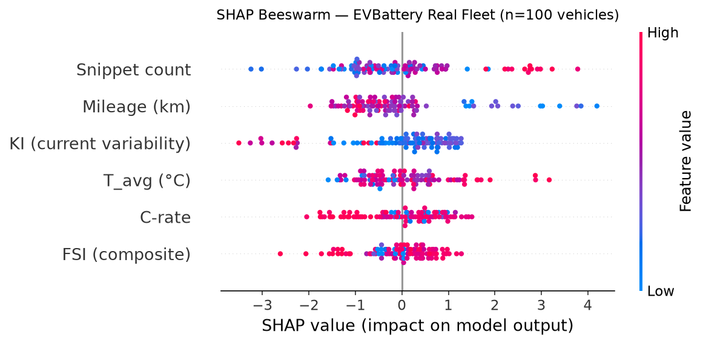

# EV Battery Fleet Severity Index

**Can a single duty-cycle score tell a fleet operator how fast its batteries are ageing?**
I built the score, tested it on about 9,000 lab ageing cycles and a 191-vehicle field dataset, and found where it works and where it does not.

MSc dissertation, Electric Vehicle Engineering, University of East London (EG7030), 2026 · Usha Rani Vamanagiri · [LinkedIn](https://www.linkedin.com/in/usharaniv3)

## At a glance

| | |
|---|---|
| **Question** | Does a Fleet Severity Index (FSI) built from duty-cycle stress explain battery State of Health (SoH)? |
| **Data** | NASA, CALCE (LCO) and Oxford (NMC) lab ageing cycles; NREL Fleet DNA duty cycles; a processed 191-vehicle EVBattery field sample |
| **Methods** | Python (pandas, scikit-learn, XGBoost, SHAP, SciPy); incremental capacity analysis; ARMA, SARIMA and exponential-smoothing RUL forecasts; battery-grouped, manufacturer-held-out and chemistry-held-out validation |
| **Answer** | FSI separates transit, refuse and delivery duty cycles and can guide inspection priorities. It is **not** a SoH or RUL estimator, and a model trained on one chemistry does not transfer to another without calibration. |

## The index

`FSI = 0.30 × KI + 0.25 × DoD + 0.25 × T + 0.20 × C-rate`

| Component | Meaning |
|---|---|
| KI | Kinetic intensity (stop-start and current variability) |
| DoD | Depth of discharge |
| T | Normalised average temperature |
| C-rate | Normalised charge/discharge rate |

Each component is min-max scaled to [0, 1] with fixed bounds.

## Main findings

1. **Results did not transfer across chemistries.** An XGBoost model reached R² = 0.77 in battery-grouped validation on CALCE cells. Trained on NASA + CALCE (LCO) and tested on Oxford NMC cells it had never seen, it fell to R² = −23.0.
2. **The field link was weak.** Across 191 vehicles, FSI vs relative capacity gave Spearman ρ = 0.217 (p = 0.0026), and the association disappeared within manufacturer groups. Leave-one-manufacturer-group-out prediction gave MAE 3.83 percentage points and R² = −0.17.
3. **SHAP shows what drives fleet SoH in this data.** Mileage and temperature carry more signal than the composite FSI.
4. **Validation design changes the answer.** Random, battery-held-out and chemistry-held-out splits give progressively worse results. A leakage audit during the project traced early high-accuracy figures to cells appearing in both training and test folds; the scripts here use battery-grouped splits throughout.
5. **Normalisation matters.** Cohort-specific scaling raised mean FSI from 0.301 to 0.392 and moved some vehicles by up to 35 ranking places.





## Run it

```bash
git clone https://github.com/Usharani1699/ev-battery-fleet-severity-index.git
cd ev-battery-fleet-severity-index
pip install -r requirements.txt

python src/evbattery_fsi_complete_pipeline.py      # 191 vehicles: rho = 0.217, MAE 3.83 pp, R² = -0.17
python src/cross_dataset_validation_CORRECTED.py   # CALCE R² ≈ 0.77 vs Oxford NMC R² ≈ -23.0
python src/evbattery_ml_analysis_RERUN.py          # XGBoost 5-fold CV + SHAP ranking
```

Each script runs in under a minute and writes to `output/`. The original run log is in [`results/verified_run_log_2026-09-01.txt`](results/verified_run_log_2026-09-01.txt). Newer library versions can shift the second decimal place of some scores; the conclusions do not change.

No local Python? Open the notebooks in [`notebooks/`](notebooks/) in Google Colab and choose **Run all**.

## Repository layout

| Folder | Contents |
|---|---|
| `src/` | Analysis scripts: FSI pipeline, cross-chemistry validation, XGBoost + SHAP |
| `data/` | Processed inputs: linked lab/fleet cycles and per-vehicle FSI tables |
| `figures/` | Charts used in the dissertation and viva |
| `results/` | Result tables, JSON summaries and the verified run log |
| `notebooks/` | Two Colab notebooks that clone this repo and reproduce the headline results |

## Limitations

NASA data contains implausible outliers that need cleaning. EVBattery health uses one fleet-wide capacity reference and its snippet-based DoD is almost constant. RUL forecasts are not validated against observed end of life. Fleet DNA has no measured SoH labels. Before using FSI as a routing or maintenance cost, it needs chemistry-aware calibration, fixed scaling, battery-held-out validation and prospective capacity testing.

## Data sources

NASA Prognostics Center of Excellence battery data; CALCE Battery Research Group, University of Maryland; Oxford Battery Degradation Dataset, University of Oxford; NREL Fleet DNA; EVBattery field dataset (processed sample). All datasets belong to their original providers; this repository contains processed extracts only.

## Citation

Vamanagiri, U. R. (2026). *A Data-Driven Fleet Severity Index for Duty-Cycle-Dependent Electric-Vehicle Battery Degradation*. MSc Dissertation, University of East London.
